# Corpus comparison

<!-- Written by make comparison (tools/visual/comparison.py). Do not edit by hand. -->

Each SVG of the corpus in four renderings: Chromium; resvg (resvg-py 0.5.0); WeasyPrint 70.0 alone; and WeasyPrint 70.0 with weasysvg. The WeasyPrint panels are PDFium rasterizations at 96 dpi; resvg renders the SVG at the width of the page. Every panel is cropped to the ink of the Chromium panel, so the four line up pixel for pixel. Each SVG has a reference: Chromium, resvg, both, or an English browser where headless Chromium matches no language. The verdicts compare weasysvg and WeasyPrint with that reference; they come from a visual review at full size, see [`verdicts.json`](verdicts.json). Click a panel for its full size. The interactive page, with large panels, your own browser and a swipe between renderers: <https://grigoriev.github.io/weasysvg/corpus/comparison.html>.

| Verdict | WeasyPrint 70.0 | WeasyPrint 70.0 with weasysvg |
|---|---|---|
| ⬆️ better than the reference | 0 | 1 |
| ✅ matches the reference | 41 | 108 |
| 🟡 close to the reference | 20 | 5 |
| ❌ differs from the reference | 54 | 1 |

References: Chromium 34, resvg 7, Chromium and resvg 73, an English browser 1.

- [Diagrams from kroki and mermaid.ink](#diagrams-from-kroki-and-mermaidink) (29)
- [draw.io](#drawio) (6)
- [foreignObject](#foreignobject) (2)
- [Wikimedia Commons](#wikimedia-commons) (14)
- [resvg feature tests](#resvg-feature-tests) (64)

## Diagrams from kroki and mermaid.ink

### diagrams__kroki-blockdiag

[`diagrams/kroki-blockdiag.svg`](svg/diagrams/kroki-blockdiag.svg)

| | Renderer | Verdict | What |
|---|---|---|---|
| 📌 | Reference | Chromium and resvg |  |
| ✅ | weasysvg | **matches the reference** | Matches: boxes, arrows and the blurred shadows. |
| 🟡 | WeasyPrint | **close to the reference** | Shadows are hard offset copies instead of blurred ones. |

| Chromium | resvg | WeasyPrint | weasysvg |
|---|---|---|---|
| <a href="render/chromium/diagrams__kroki-blockdiag.png">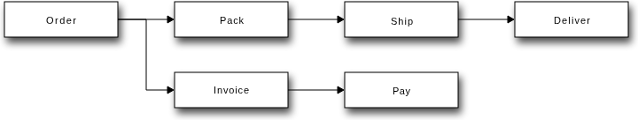</a> | <a href="render/resvg/diagrams__kroki-blockdiag.png">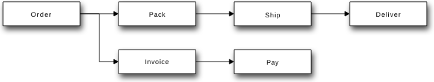</a> | <a href="render/weasyprint/diagrams__kroki-blockdiag.png">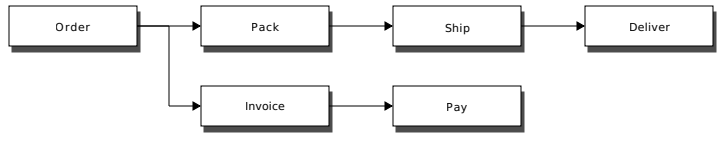</a> | <a href="render/weasysvg/diagrams__kroki-blockdiag.png">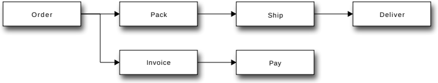</a> |

### diagrams__kroki-bpmn

[`diagrams/kroki-bpmn.svg`](svg/diagrams/kroki-bpmn.svg)

| | Renderer | Verdict | What |
|---|---|---|---|
| 📌 | Reference | Chromium and resvg |  |
| ✅ | weasysvg | **matches the reference** | Matches. |
| ✅ | WeasyPrint | **matches the reference** | Matches. |

| Chromium | resvg | WeasyPrint | weasysvg |
|---|---|---|---|
| <a href="render/chromium/diagrams__kroki-bpmn.png">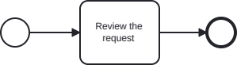</a> | <a href="render/resvg/diagrams__kroki-bpmn.png">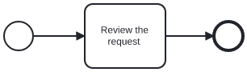</a> | <a href="render/weasyprint/diagrams__kroki-bpmn.png">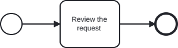</a> |  |

### diagrams__kroki-c4plantuml

[`diagrams/kroki-c4plantuml.svg`](svg/diagrams/kroki-c4plantuml.svg)

| | Renderer | Verdict | What |
|---|---|---|---|
| 📌 | Reference | Chromium and resvg |  |
| ✅ | weasysvg | **matches the reference** | Matches, fonts included. |
| 🟡 | WeasyPrint | **close to the reference** | Same drawing in another font. |

| Chromium | resvg | WeasyPrint | weasysvg |
|---|---|---|---|
| <a href="render/chromium/diagrams__kroki-c4plantuml.png">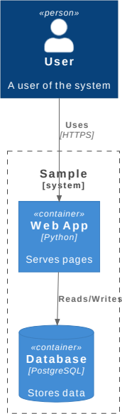</a> | <a href="render/resvg/diagrams__kroki-c4plantuml.png">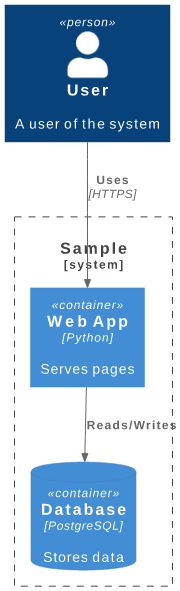</a> | <a href="render/weasyprint/diagrams__kroki-c4plantuml.png">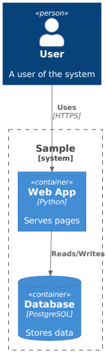</a> |  |

### diagrams__kroki-d2-arch

[`diagrams/kroki-d2-arch.svg`](svg/diagrams/kroki-d2-arch.svg)

| | Renderer | Verdict | What |
|---|---|---|---|
| 📌 | Reference | Chromium | resvg ignores the @font-face fonts the SVG embeds and falls back to a serif. |
| ✅ | weasysvg | **matches the reference** | Matches, with the embedded fonts. |
| ❌ | WeasyPrint | **differs from the reference** | Nothing but a black rectangle: the SVG is lost. |

| Chromium | resvg | WeasyPrint | weasysvg |
|---|---|---|---|
| <a href="render/chromium/diagrams__kroki-d2-arch.png">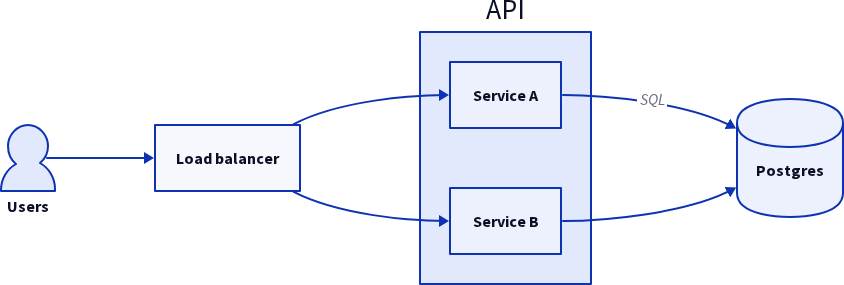</a> | <a href="render/resvg/diagrams__kroki-d2-arch.png">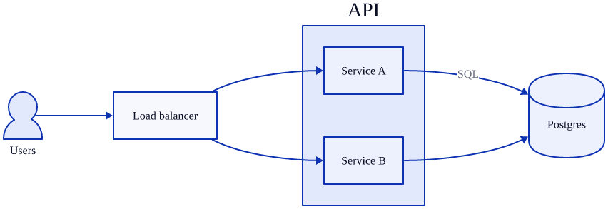</a> | <a href="render/weasyprint/diagrams__kroki-d2-arch.png">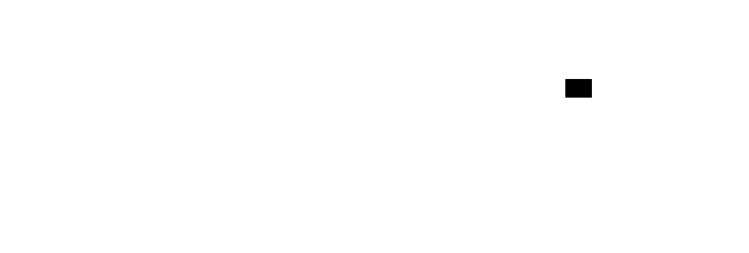</a> | <a href="render/weasysvg/diagrams__kroki-d2-arch.png">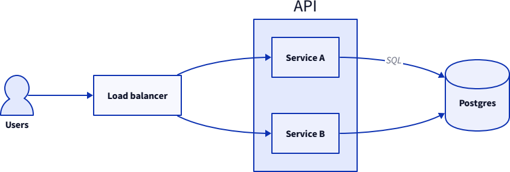</a> |

### diagrams__kroki-d2

[`diagrams/kroki-d2.svg`](svg/diagrams/kroki-d2.svg)

| | Renderer | Verdict | What |
|---|---|---|---|
| 📌 | Reference | Chromium | resvg ignores the embedded @font-face fonts. |
| ✅ | weasysvg | **matches the reference** | Matches. |
| ❌ | WeasyPrint | **differs from the reference** | Two black bars instead of the diagram. |

| Chromium | resvg | WeasyPrint | weasysvg |
|---|---|---|---|
| <a href="render/chromium/diagrams__kroki-d2.png">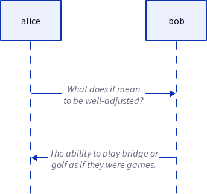</a> | <a href="render/resvg/diagrams__kroki-d2.png">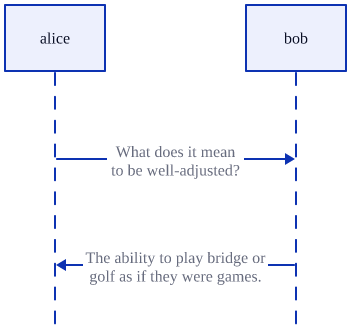</a> | <a href="render/weasyprint/diagrams__kroki-d2.png">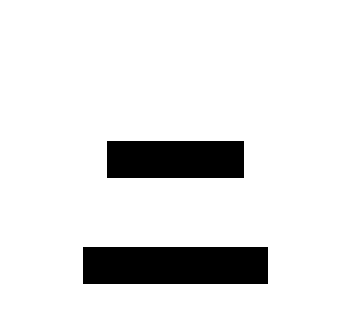</a> | <a href="render/weasysvg/diagrams__kroki-d2.png">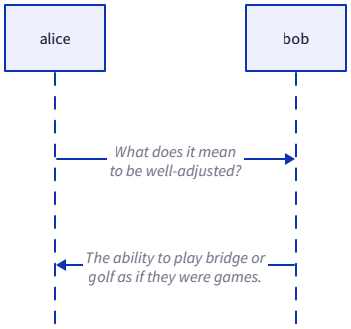</a> |

### diagrams__kroki-erd

[`diagrams/kroki-erd.svg`](svg/diagrams/kroki-erd.svg)

| | Renderer | Verdict | What |
|---|---|---|---|
| 📌 | Reference | Chromium | resvg draws the sans-serif labels in a serif. |
| ✅ | weasysvg | **matches the reference** | Matches, underlined keys included. |
| 🟡 | WeasyPrint | **close to the reference** | The key fields name and id lose their underline; the font differs. |

| Chromium | resvg | WeasyPrint | weasysvg |
|---|---|---|---|
| <a href="render/chromium/diagrams__kroki-erd.png">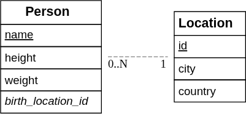</a> | <a href="render/resvg/diagrams__kroki-erd.png">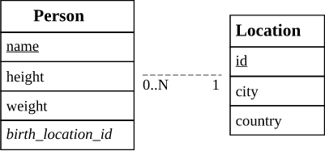</a> | <a href="render/weasyprint/diagrams__kroki-erd.png">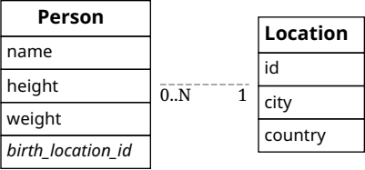</a> | <a href="render/weasysvg/diagrams__kroki-erd.png">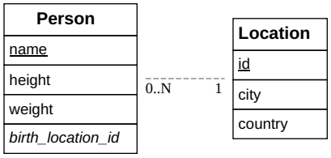</a> |

### diagrams__kroki-excalidraw

[`diagrams/kroki-excalidraw.svg`](svg/diagrams/kroki-excalidraw.svg)

| | Renderer | Verdict | What |
|---|---|---|---|
| 📌 | Reference | Chromium | resvg ignores the embedded hand-drawn font. |
| ✅ | weasysvg | **matches the reference** | Matches, hand-drawn font included. |
| 🟡 | WeasyPrint | **close to the reference** | Wider gap between the words. |

| Chromium | resvg | WeasyPrint | weasysvg |
|---|---|---|---|
| <a href="render/chromium/diagrams__kroki-excalidraw.png">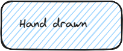</a> | <a href="render/resvg/diagrams__kroki-excalidraw.png">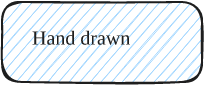</a> | <a href="render/weasyprint/diagrams__kroki-excalidraw.png">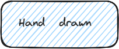</a> | <a href="render/weasysvg/diagrams__kroki-excalidraw.png">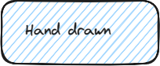</a> |

### diagrams__kroki-graphviz

[`diagrams/kroki-graphviz.svg`](svg/diagrams/kroki-graphviz.svg)

| | Renderer | Verdict | What |
|---|---|---|---|
| 📌 | Reference | Chromium and resvg |  |
| ✅ | weasysvg | **matches the reference** | Matches. |
| 🟡 | WeasyPrint | **close to the reference** | Same drawing in another font. |

| Chromium | resvg | WeasyPrint | weasysvg |
|---|---|---|---|
|  | <a href="render/resvg/diagrams__kroki-graphviz.png">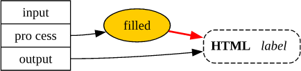</a> | <a href="render/weasyprint/diagrams__kroki-graphviz.png">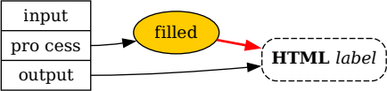</a> | <a href="render/weasysvg/diagrams__kroki-graphviz.png">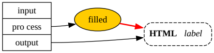</a> |

### diagrams__kroki-mermaid-er

[`diagrams/kroki-mermaid-er.svg`](svg/diagrams/kroki-mermaid-er.svg)

| | Renderer | Verdict | What |
|---|---|---|---|
| 📌 | Reference | Chromium | resvg has no foreignObject: every label is missing. |
| ✅ | weasysvg | **matches the reference** | Matches, labels included. |
| ❌ | WeasyPrint | **differs from the reference** | All labels are missing. |

| Chromium | resvg | WeasyPrint | weasysvg |
|---|---|---|---|
| <a href="render/chromium/diagrams__kroki-mermaid-er.png">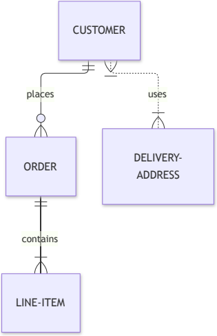</a> | <a href="render/resvg/diagrams__kroki-mermaid-er.png">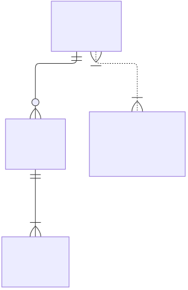</a> |  | <a href="render/weasysvg/diagrams__kroki-mermaid-er.png">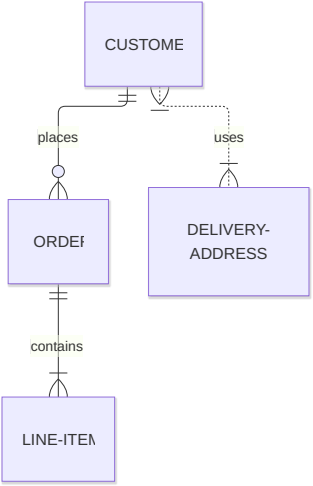</a> |

### diagrams__kroki-mermaid-mindmap

[`diagrams/kroki-mermaid-mindmap.svg`](svg/diagrams/kroki-mermaid-mindmap.svg)

| | Renderer | Verdict | What |
|---|---|---|---|
| 📌 | Reference | Chromium | resvg has no foreignObject: every label is missing. |
| ✅ | weasysvg | **matches the reference** | Matches. |
| ❌ | WeasyPrint | **differs from the reference** | All labels are missing. |

| Chromium | resvg | WeasyPrint | weasysvg |
|---|---|---|---|
|  | <a href="render/resvg/diagrams__kroki-mermaid-mindmap.png">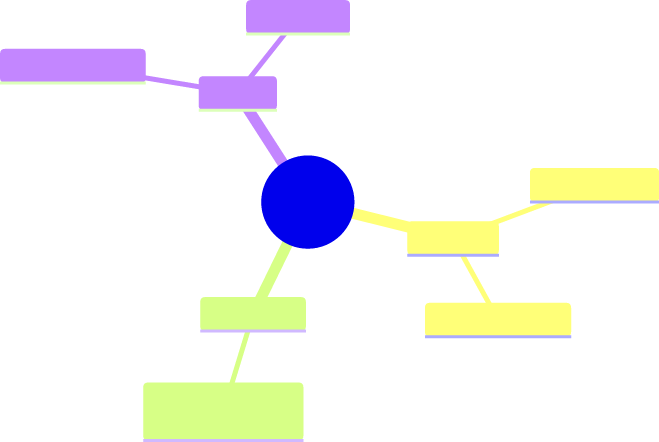</a> | <a href="render/weasyprint/diagrams__kroki-mermaid-mindmap.png">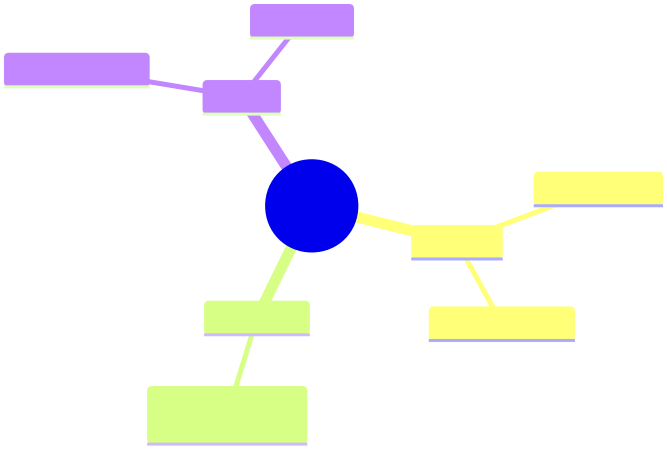</a> |  |

### diagrams__kroki-mermaid-state

[`diagrams/kroki-mermaid-state.svg`](svg/diagrams/kroki-mermaid-state.svg)

| | Renderer | Verdict | What |
|---|---|---|---|
| 📌 | Reference | Chromium | resvg has no foreignObject: every label is missing. |
| ✅ | weasysvg | **matches the reference** | Matches. |
| ❌ | WeasyPrint | **differs from the reference** | All labels are missing. |

| Chromium | resvg | WeasyPrint | weasysvg |
|---|---|---|---|
| <a href="render/chromium/diagrams__kroki-mermaid-state.png">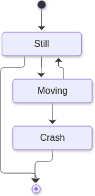</a> | <a href="render/resvg/diagrams__kroki-mermaid-state.png">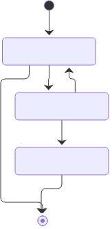</a> | <a href="render/weasyprint/diagrams__kroki-mermaid-state.png">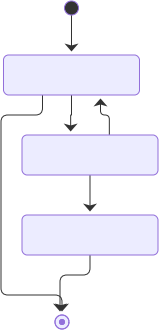</a> | <a href="render/weasysvg/diagrams__kroki-mermaid-state.png">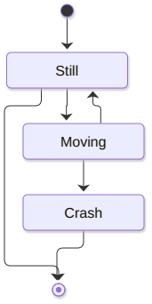</a> |

### diagrams__kroki-nomnoml

[`diagrams/kroki-nomnoml.svg`](svg/diagrams/kroki-nomnoml.svg)

| | Renderer | Verdict | What |
|---|---|---|---|
| 📌 | Reference | Chromium | resvg draws no text at all here. |
| ✅ | weasysvg | **matches the reference** | Matches. |
| ✅ | WeasyPrint | **matches the reference** | Matches. |

| Chromium | resvg | WeasyPrint | weasysvg |
|---|---|---|---|
| <a href="render/chromium/diagrams__kroki-nomnoml.png">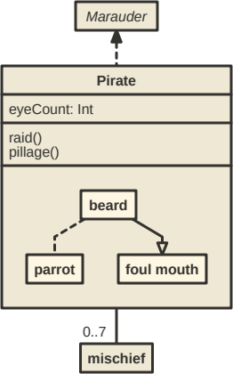</a> | <a href="render/resvg/diagrams__kroki-nomnoml.png">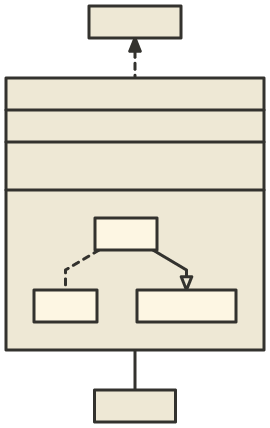</a> |  | <a href="render/weasysvg/diagrams__kroki-nomnoml.png">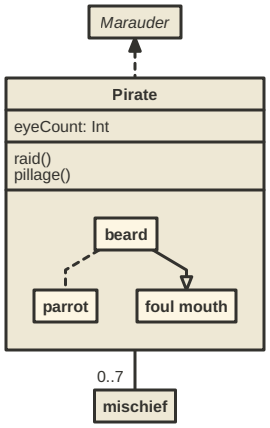</a> |

### diagrams__kroki-pikchr

[`diagrams/kroki-pikchr.svg`](svg/diagrams/kroki-pikchr.svg)

| | Renderer | Verdict | What |
|---|---|---|---|
| 📌 | Reference | Chromium and resvg |  |
| ✅ | weasysvg | **matches the reference** | Matches. |
| ❌ | WeasyPrint | **differs from the reference** | All text is missing. |

| Chromium | resvg | WeasyPrint | weasysvg |
|---|---|---|---|
| <a href="render/chromium/diagrams__kroki-pikchr.png">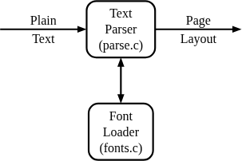</a> | <a href="render/resvg/diagrams__kroki-pikchr.png">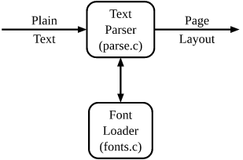</a> | <a href="render/weasyprint/diagrams__kroki-pikchr.png">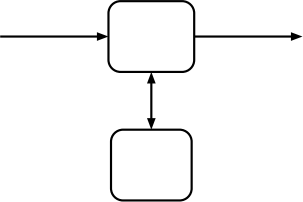</a> | <a href="render/weasysvg/diagrams__kroki-pikchr.png">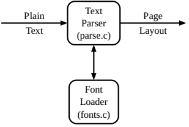</a> |

### diagrams__kroki-plantuml-activity

[`diagrams/kroki-plantuml-activity.svg`](svg/diagrams/kroki-plantuml-activity.svg)

| | Renderer | Verdict | What |
|---|---|---|---|
| 📌 | Reference | Chromium | resvg draws the underline under &#x27;waiting&#x27; through the descenders; Chromium skips their ink. |
| 🟡 | weasysvg | **close to the reference** | The underline under &#x27;waiting&#x27; runs whole: the text has a textLength, so it is laid out character by character and skips no ink. Chromium cuts it under each glyph. |
| 🟡 | WeasyPrint | **close to the reference** | The underline under &#x27;waiting&#x27; is missing. |

| Chromium | resvg | WeasyPrint | weasysvg |
|---|---|---|---|
|  | <a href="render/resvg/diagrams__kroki-plantuml-activity.png">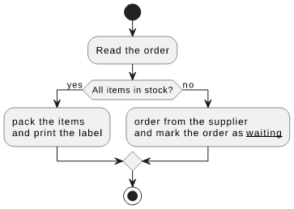</a> | <a href="render/weasyprint/diagrams__kroki-plantuml-activity.png">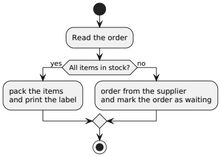</a> | <a href="render/weasysvg/diagrams__kroki-plantuml-activity.png">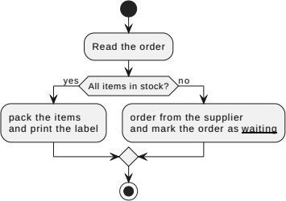</a> |

### diagrams__kroki-plantuml-sequence

[`diagrams/kroki-plantuml-sequence.svg`](svg/diagrams/kroki-plantuml-sequence.svg)

| | Renderer | Verdict | What |
|---|---|---|---|
| 📌 | Reference | Chromium and resvg |  |
| ✅ | weasysvg | **matches the reference** | Matches. |
| ✅ | WeasyPrint | **matches the reference** | Matches. |

| Chromium | resvg | WeasyPrint | weasysvg |
|---|---|---|---|
| <a href="render/chromium/diagrams__kroki-plantuml-sequence.png">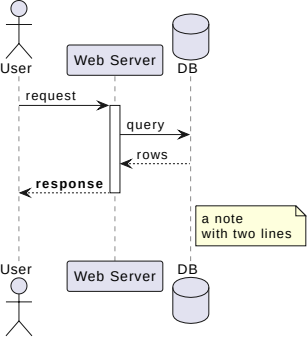</a> | <a href="render/resvg/diagrams__kroki-plantuml-sequence.png">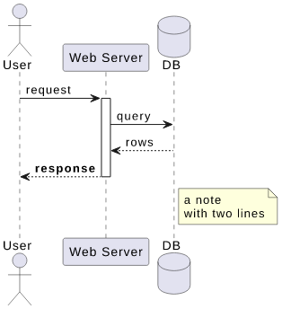</a> |  |  |

### diagrams__kroki-structurizr

[`diagrams/kroki-structurizr.svg`](svg/diagrams/kroki-structurizr.svg)

| | Renderer | Verdict | What |
|---|---|---|---|
| 📌 | Reference | Chromium and resvg |  |
| ✅ | weasysvg | **matches the reference** | Matches. |
| ✅ | WeasyPrint | **matches the reference** | Matches. |

| Chromium | resvg | WeasyPrint | weasysvg |
|---|---|---|---|
|  |  |  |  |

### diagrams__kroki-svgbob

[`diagrams/kroki-svgbob.svg`](svg/diagrams/kroki-svgbob.svg)

| | Renderer | Verdict | What |
|---|---|---|---|
| 📌 | Reference | Chromium and resvg |  |
| ✅ | weasysvg | **matches the reference** | Matches. |
| ✅ | WeasyPrint | **matches the reference** | Matches. |

| Chromium | resvg | WeasyPrint | weasysvg |
|---|---|---|---|
|  |  |  |  |

### diagrams__kroki-vegalite

[`diagrams/kroki-vegalite.svg`](svg/diagrams/kroki-vegalite.svg)

| | Renderer | Verdict | What |
|---|---|---|---|
| 📌 | Reference | Chromium and resvg |  |
| ✅ | weasysvg | **matches the reference** | Matches. |
| ✅ | WeasyPrint | **matches the reference** | Matches. |

| Chromium | resvg | WeasyPrint | weasysvg |
|---|---|---|---|
|  |  |  |  |

### diagrams__kroki-wavedrom

[`diagrams/kroki-wavedrom.svg`](svg/diagrams/kroki-wavedrom.svg)

| | Renderer | Verdict | What |
|---|---|---|---|
| 📌 | Reference | Chromium | resvg drops the lane labels and the fills of the data cells. |
| ✅ | weasysvg | **matches the reference** | Matches. |
| ✅ | WeasyPrint | **matches the reference** | Matches. |

| Chromium | resvg | WeasyPrint | weasysvg |
|---|---|---|---|
|  |  |  |  |

### diagrams__mermaid-ink-class

[`diagrams/mermaid-ink-class.svg`](svg/diagrams/mermaid-ink-class.svg)

| | Renderer | Verdict | What |
|---|---|---|---|
| 📌 | Reference | Chromium | resvg has no foreignObject: every label is missing. |
| ✅ | weasysvg | **matches the reference** | Matches. |
| ❌ | WeasyPrint | **differs from the reference** | All labels are missing. |

| Chromium | resvg | WeasyPrint | weasysvg |
|---|---|---|---|
|  |  |  |  |

### diagrams__mermaid-ink-er

[`diagrams/mermaid-ink-er.svg`](svg/diagrams/mermaid-ink-er.svg)

| | Renderer | Verdict | What |
|---|---|---|---|
| 📌 | Reference | Chromium | resvg has no foreignObject: every label is missing. |
| ✅ | weasysvg | **matches the reference** | Matches. |
| ❌ | WeasyPrint | **differs from the reference** | All labels are missing. |

| Chromium | resvg | WeasyPrint | weasysvg |
|---|---|---|---|
|  |  |  |  |

### diagrams__mermaid-ink-flowchart

[`diagrams/mermaid-ink-flowchart.svg`](svg/diagrams/mermaid-ink-flowchart.svg)

| | Renderer | Verdict | What |
|---|---|---|---|
| 📌 | Reference | Chromium | resvg has no foreignObject: every label is missing. |
| 🟡 | weasysvg | **close to the reference** | The label Car sits 3 px right of where Chromium puts it; the rest matches. |
| ❌ | WeasyPrint | **differs from the reference** | All labels are missing. |

| Chromium | resvg | WeasyPrint | weasysvg |
|---|---|---|---|
|  |  |  |  |

### diagrams__mermaid-ink-gantt

[`diagrams/mermaid-ink-gantt.svg`](svg/diagrams/mermaid-ink-gantt.svg)

| | Renderer | Verdict | What |
|---|---|---|---|
| 📌 | Reference | Chromium and resvg |  |
| ✅ | weasysvg | **matches the reference** | Matches. |
| 🟡 | WeasyPrint | **close to the reference** | The axis dates lose their year: 01-05 instead of 2014-01-05. |

| Chromium | resvg | WeasyPrint | weasysvg |
|---|---|---|---|
|  |  |  |  |

### diagrams__mermaid-ink-gitgraph

[`diagrams/mermaid-ink-gitgraph.svg`](svg/diagrams/mermaid-ink-gitgraph.svg)

| | Renderer | Verdict | What |
|---|---|---|---|
| 📌 | Reference | Chromium and resvg |  |
| ✅ | weasysvg | **matches the reference** | Matches. |
| ✅ | WeasyPrint | **matches the reference** | Matches. |

| Chromium | resvg | WeasyPrint | weasysvg |
|---|---|---|---|
|  |  |  |  |

### diagrams__mermaid-ink-journey

[`diagrams/mermaid-ink-journey.svg`](svg/diagrams/mermaid-ink-journey.svg)

| | Renderer | Verdict | What |
|---|---|---|---|
| 📌 | Reference | Chromium | The title has fill=&quot;&quot;, which browsers ignore: it takes #333 from the CSS of the root, as in Chromium. resvg draws it black. |
| ✅ | weasysvg | **matches the reference** | Matches, the title sized 4ex from the x-height of the font, as in Chromium. |
| ❌ | WeasyPrint | **differs from the reference** | The title, with fill=&quot;&quot;, and the labels of the two sections are missing. |

| Chromium | resvg | WeasyPrint | weasysvg |
|---|---|---|---|
|  |  |  |  |

### diagrams__mermaid-ink-mindmap

[`diagrams/mermaid-ink-mindmap.svg`](svg/diagrams/mermaid-ink-mindmap.svg)

| | Renderer | Verdict | What |
|---|---|---|---|
| 📌 | Reference | Chromium | resvg has no foreignObject: every label is missing. |
| ✅ | weasysvg | **matches the reference** | Matches. |
| ❌ | WeasyPrint | **differs from the reference** | All labels are missing. |

| Chromium | resvg | WeasyPrint | weasysvg |
|---|---|---|---|
|  |  |  |  |

### diagrams__mermaid-ink-pie

[`diagrams/mermaid-ink-pie.svg`](svg/diagrams/mermaid-ink-pie.svg)

| | Renderer | Verdict | What |
|---|---|---|---|
| 📌 | Reference | Chromium and resvg |  |
| ✅ | weasysvg | **matches the reference** | Matches. |
| ✅ | WeasyPrint | **matches the reference** | Matches. |

| Chromium | resvg | WeasyPrint | weasysvg |
|---|---|---|---|
|  |  |  |  |

### diagrams__mermaid-ink-sequence

[`diagrams/mermaid-ink-sequence.svg`](svg/diagrams/mermaid-ink-sequence.svg)

| | Renderer | Verdict | What |
|---|---|---|---|
| 📌 | Reference | Chromium and resvg |  |
| ✅ | weasysvg | **matches the reference** | Matches. |
| ✅ | WeasyPrint | **matches the reference** | Matches. |

| Chromium | resvg | WeasyPrint | weasysvg |
|---|---|---|---|
|  |  |  |  |

### diagrams__mermaid-ink-state

[`diagrams/mermaid-ink-state.svg`](svg/diagrams/mermaid-ink-state.svg)

| | Renderer | Verdict | What |
|---|---|---|---|
| 📌 | Reference | Chromium | resvg has no foreignObject: every label is missing. |
| ✅ | weasysvg | **matches the reference** | Matches. |
| ❌ | WeasyPrint | **differs from the reference** | All labels are missing. |

| Chromium | resvg | WeasyPrint | weasysvg |
|---|---|---|---|
|  |  |  |  |

## draw.io

### drawio__connect-shapes

[`drawio/connect-shapes.svg`](svg/drawio/connect-shapes.svg)

| | Renderer | Verdict | What |
|---|---|---|---|
| 📌 | Reference | Chromium | resvg draws the labels in a serif. |
| ✅ | weasysvg | **matches the reference** | Matches, the underlines of the links skip the ink as in Chromium. The remote GIFs are blocked in every rendering, by policy. |
| 🟡 | WeasyPrint | **close to the reference** | The links lose their underline. |

| Chromium | resvg | WeasyPrint | weasysvg |
|---|---|---|---|
|  |  |  |  |

### drawio__flowchart.drawio

[`drawio/flowchart.drawio.svg`](svg/drawio/flowchart.drawio.svg)

| | Renderer | Verdict | What |
|---|---|---|---|
| 📌 | Reference | Chromium | resvg ignores the switch with requiredFeatures and shows the fallback text &#x27;Text is not SVG&#x27;. |
| ✅ | weasysvg | **matches the reference** | Matches. |
| ❌ | WeasyPrint | **differs from the reference** | Labels are cut to &#x27;Lamp...&#x27; and the fallback text &#x27;Text is not SVG&#x27; shows. |

| Chromium | resvg | WeasyPrint | weasysvg |
|---|---|---|---|
|  |  |  |  |

### drawio__infographic

[`drawio/infographic.svg`](svg/drawio/infographic.svg)

| | Renderer | Verdict | What |
|---|---|---|---|
| 📌 | Reference | Chromium | resvg shows raw HTML source in place of the foreignObject text. |
| ✅ | weasysvg | **matches the reference** | Matches. |
| ❌ | WeasyPrint | **differs from the reference** | Most text is missing, raw HTML shows. |

| Chromium | resvg | WeasyPrint | weasysvg |
|---|---|---|---|
|  |  |  |  |

### drawio__infographic2

[`drawio/infographic2.svg`](svg/drawio/infographic2.svg)

| | Renderer | Verdict | What |
|---|---|---|---|
| 📌 | Reference | Chromium | resvg shows &#x27;Not supported by viewer&#x27; fallbacks. |
| ✅ | weasysvg | **matches the reference** | Matches. |
| ❌ | WeasyPrint | **differs from the reference** | &#x27;Not supported by viewer&#x27; fallbacks show in large orange type. |

| Chromium | resvg | WeasyPrint | weasysvg |
|---|---|---|---|
|  |  |  |  |

### drawio__notion-template.drawio

[`drawio/notion-template.drawio.svg`](svg/drawio/notion-template.drawio.svg)

| | Renderer | Verdict | What |
|---|---|---|---|
| 📌 | Reference | Chromium | resvg shows the fallback &#x27;Click Here to...&#x27;. |
| ✅ | weasysvg | **matches the reference** | Matches. |
| ❌ | WeasyPrint | **differs from the reference** | Shows the fallback &#x27;Click Here to...&#x27;. |

| Chromium | resvg | WeasyPrint | weasysvg |
|---|---|---|---|
|  |  |  |  |

### drawio__svgfile

[`drawio/svgfile.svg`](svg/drawio/svgfile.svg)

| | Renderer | Verdict | What |
|---|---|---|---|
| 📌 | Reference | Chromium | resvg shows &#x27;Not supported by viewer&#x27; fallbacks. |
| 🟡 | weasysvg | **close to the reference** | One AsciiMath label breaks its line at another word. |
| ❌ | WeasyPrint | **differs from the reference** | Fallback texts in place of the labels. |

| Chromium | resvg | WeasyPrint | weasysvg |
|---|---|---|---|
|  |  |  |  |

## foreignObject

### fo__mdn-foreignobject

[`fo/mdn-foreignobject.svg`](svg/fo/mdn-foreignobject.svg)

| | Renderer | Verdict | What |
|---|---|---|---|
| 📌 | Reference | Chromium | resvg has no foreignObject: the box stays empty. |
| ⬆️ | weasysvg | **better than the reference** | Better for print: no scrollbar for overflow: auto, which paper cannot scroll. The text takes the full width of the box, and one more line shows. |
| ❌ | WeasyPrint | **differs from the reference** | The box is empty. |

| Chromium | resvg | WeasyPrint | weasysvg |
|---|---|---|---|
|  |  |  |  |

### fo__rich-html

[`fo/rich-html.svg`](svg/fo/rich-html.svg)

| | Renderer | Verdict | What |
|---|---|---|---|
| 📌 | Reference | Chromium | resvg has no foreignObject. |
| ✅ | weasysvg | **matches the reference** | Matches: heading, list with its markers, table and the rotated paragraph. |
| ❌ | WeasyPrint | **differs from the reference** | All HTML content is missing. |

| Chromium | resvg | WeasyPrint | weasysvg |
|---|---|---|---|
|  |  |  |  |

## Wikimedia Commons

### real__wm-Bitmap_VS_SVG

[`real/wm-Bitmap_VS_SVG.svg`](svg/real/wm-Bitmap_VS_SVG.svg)

| | Renderer | Verdict | What |
|---|---|---|---|
| 📌 | Reference | an English browser | Chromium of the references ran with no English language: the switch has no fallback child, so it drew no title. An English browser shows Raster and Vector, as weasysvg does (see the browser panel). |
| ✅ | weasysvg | **matches the reference** | Matches an English browser: Raster and Vector titles. |
| ❌ | WeasyPrint | **differs from the reference** | All translations of the titles are drawn on top of each other. |

| Chromium | resvg | WeasyPrint | weasysvg |
|---|---|---|---|
|  |  |  |  |

### real__wm-Flag_of_Brazil

[`real/wm-Flag_of_Brazil.svg`](svg/real/wm-Flag_of_Brazil.svg)

| | Renderer | Verdict | What |
|---|---|---|---|
| 📌 | Reference | Chromium and resvg |  |
| ✅ | weasysvg | **matches the reference** | Matches. |
| ✅ | WeasyPrint | **matches the reference** | Matches. |

| Chromium | resvg | WeasyPrint | weasysvg |
|---|---|---|---|
|  |  |  |  |

### real__wm-Flag_of_Switzerland

[`real/wm-Flag_of_Switzerland.svg`](svg/real/wm-Flag_of_Switzerland.svg)

| | Renderer | Verdict | What |
|---|---|---|---|
| 📌 | Reference | Chromium and resvg |  |
| ✅ | weasysvg | **matches the reference** | Matches. |
| ✅ | WeasyPrint | **matches the reference** | Matches. |

| Chromium | resvg | WeasyPrint | weasysvg |
|---|---|---|---|
|  |  |  |  |

### real__wm-Flag_of_the_United_Kingdom

[`real/wm-Flag_of_the_United_Kingdom.svg`](svg/real/wm-Flag_of_the_United_Kingdom.svg)

| | Renderer | Verdict | What |
|---|---|---|---|
| 📌 | Reference | Chromium and resvg |  |
| ✅ | weasysvg | **matches the reference** | Matches. |
| ✅ | WeasyPrint | **matches the reference** | Matches. |

| Chromium | resvg | WeasyPrint | weasysvg |
|---|---|---|---|
|  |  |  |  |

### real__wm-Git-logo

[`real/wm-Git-logo.svg`](svg/real/wm-Git-logo.svg)

| | Renderer | Verdict | What |
|---|---|---|---|
| 📌 | Reference | Chromium and resvg |  |
| ✅ | weasysvg | **matches the reference** | Matches. |
| ✅ | WeasyPrint | **matches the reference** | Matches. |

| Chromium | resvg | WeasyPrint | weasysvg |
|---|---|---|---|
|  |  |  |  |

### real__wm-Inkscape_Logo

[`real/wm-Inkscape_Logo.svg`](svg/real/wm-Inkscape_Logo.svg)

| | Renderer | Verdict | What |
|---|---|---|---|
| 📌 | Reference | Chromium | resvg fills some shapes black instead of their gradients. |
| ✅ | weasysvg | **matches the reference** | Matches. |
| ✅ | WeasyPrint | **matches the reference** | Matches. |

| Chromium | resvg | WeasyPrint | weasysvg |
|---|---|---|---|
|  |  |  |  |

### real__wm-Kubernetes_logo_without_workmark

[`real/wm-Kubernetes_logo_without_workmark.svg`](svg/real/wm-Kubernetes_logo_without_workmark.svg)

| | Renderer | Verdict | What |
|---|---|---|---|
| 📌 | Reference | Chromium and resvg |  |
| ✅ | weasysvg | **matches the reference** | Matches. |
| ✅ | WeasyPrint | **matches the reference** | Matches. |

| Chromium | resvg | WeasyPrint | weasysvg |
|---|---|---|---|
|  |  |  |  |

### real__wm-OSI_Model_v1

[`real/wm-OSI_Model_v1.svg`](svg/real/wm-OSI_Model_v1.svg)

| | Renderer | Verdict | What |
|---|---|---|---|
| 📌 | Reference | Chromium | resvg drops the second line of every label. |
| ✅ | weasysvg | **matches the reference** | Matches: every label and its lines are centered as in Chromium. |
| ❌ | WeasyPrint | **differs from the reference** | All translations of every label are drawn on top of each other. |

| Chromium | resvg | WeasyPrint | weasysvg |
|---|---|---|---|
|  |  |  |  |

### real__wm-Openstreetmap_logo

[`real/wm-Openstreetmap_logo.svg`](svg/real/wm-Openstreetmap_logo.svg)

| | Renderer | Verdict | What |
|---|---|---|---|
| 📌 | Reference | Chromium and resvg |  |
| 🟡 | weasysvg | **close to the reference** | The shadow of the lens ring is darker and sharper than in Chromium: the ring is a filled shape thinner than two deviations, and the levels of a blur know only the nearest edge. |
| ❌ | WeasyPrint | **differs from the reference** | No shadows, and the handle is a flat dark shape. |

| Chromium | resvg | WeasyPrint | weasysvg |
|---|---|---|---|
|  |  |  |  |

### real__wm-Python-logo-notext

[`real/wm-Python-logo-notext.svg`](svg/real/wm-Python-logo-notext.svg)

| | Renderer | Verdict | What |
|---|---|---|---|
| 📌 | Reference | Chromium and resvg |  |
| ✅ | weasysvg | **matches the reference** | Matches. |
| ✅ | WeasyPrint | **matches the reference** | Matches. |

| Chromium | resvg | WeasyPrint | weasysvg |
|---|---|---|---|
|  |  |  |  |

### real__wm-SVG_Logo

[`real/wm-SVG_Logo.svg`](svg/real/wm-SVG_Logo.svg)

| | Renderer | Verdict | What |
|---|---|---|---|
| 📌 | Reference | Chromium and resvg |  |
| ✅ | weasysvg | **matches the reference** | Matches. |
| ✅ | WeasyPrint | **matches the reference** | Matches. |

| Chromium | resvg | WeasyPrint | weasysvg |
|---|---|---|---|
|  |  |  |  |

### real__wm-Simple_Periodic_Table_Chart-blocks

[`real/wm-Simple_Periodic_Table_Chart-blocks.svg`](svg/real/wm-Simple_Periodic_Table_Chart-blocks.svg)

| | Renderer | Verdict | What |
|---|---|---|---|
| 📌 | Reference | Chromium and resvg |  |
| ✅ | weasysvg | **matches the reference** | Matches: each number and symbol is centered in its cell. |
| ❌ | WeasyPrint | **differs from the reference** | All translations of every label are drawn on top of each other. |

| Chromium | resvg | WeasyPrint | weasysvg |
|---|---|---|---|
|  |  |  |  |

### real__wm-Tux

[`real/wm-Tux.svg`](svg/real/wm-Tux.svg)

| | Renderer | Verdict | What |
|---|---|---|---|
| 📌 | Reference | Chromium and resvg |  |
| ✅ | weasysvg | **matches the reference** | Matches, the blurred shading of the feet included. |
| 🟡 | WeasyPrint | **close to the reference** | The soft shading under the feet is missing: hard edges instead. |

| Chromium | resvg | WeasyPrint | weasysvg |
|---|---|---|---|
|  |  |  |  |

### real__wm-Wikimedia-logo

[`real/wm-Wikimedia-logo.svg`](svg/real/wm-Wikimedia-logo.svg)

| | Renderer | Verdict | What |
|---|---|---|---|
| 📌 | Reference | Chromium and resvg |  |
| ✅ | weasysvg | **matches the reference** | Matches. |
| ✅ | WeasyPrint | **matches the reference** | Matches. |

| Chromium | resvg | WeasyPrint | weasysvg |
|---|---|---|---|
|  |  |  |  |

## resvg feature tests

### resvg__filters-feColorMatrix--type=luminanceToAlpha

[`resvg/filters-feColorMatrix--type=luminanceToAlpha.svg`](svg/resvg/filters-feColorMatrix--type=luminanceToAlpha.svg)

| | Renderer | Verdict | What |
|---|---|---|---|
| 📌 | Reference | Chromium and resvg |  |
| ✅ | weasysvg | **matches the reference** | Matches. |
| ❌ | WeasyPrint | **differs from the reference** | The filter is dropped: the rainbow gradient shows in color. |

| Chromium | resvg | WeasyPrint | weasysvg |
|---|---|---|---|
|  |  |  |  |

### resvg__filters-feColorMatrix--type=matrix-with-non-normalized-values

[`resvg/filters-feColorMatrix--type=matrix-with-non-normalized-values.svg`](svg/resvg/filters-feColorMatrix--type=matrix-with-non-normalized-values.svg)

| | Renderer | Verdict | What |
|---|---|---|---|
| 📌 | Reference | Chromium and resvg |  |
| ✅ | weasysvg | **matches the reference** | Matches. |
| ❌ | WeasyPrint | **differs from the reference** | The filter is dropped: the rainbow gradient shows in color. |

| Chromium | resvg | WeasyPrint | weasysvg |
|---|---|---|---|
|  |  |  |  |

### resvg__filters-feComposite--operator=arithmetic-with-large-k1-4

[`resvg/filters-feComposite--operator=arithmetic-with-large-k1-4.svg`](svg/resvg/filters-feComposite--operator=arithmetic-with-large-k1-4.svg)

| | Renderer | Verdict | What |
|---|---|---|---|
| 📌 | Reference | Chromium and resvg |  |
| ✅ | weasysvg | **matches the reference** | Matches. |
| ❌ | WeasyPrint | **differs from the reference** | The filter is dropped: a plain green square. |

| Chromium | resvg | WeasyPrint | weasysvg |
|---|---|---|---|
|  |  |  |  |

### resvg__filters-feComposite--operator=over

[`resvg/filters-feComposite--operator=over.svg`](svg/resvg/filters-feComposite--operator=over.svg)

| | Renderer | Verdict | What |
|---|---|---|---|
| 📌 | Reference | Chromium and resvg |  |
| ✅ | weasysvg | **matches the reference** | Matches. |
| ❌ | WeasyPrint | **differs from the reference** | The filter is dropped: a plain green square. |

| Chromium | resvg | WeasyPrint | weasysvg |
|---|---|---|---|
|  |  |  |  |

### resvg__filters-feDropShadow--hsla-color

[`resvg/filters-feDropShadow--hsla-color.svg`](svg/resvg/filters-feDropShadow--hsla-color.svg)

| | Renderer | Verdict | What |
|---|---|---|---|
| 📌 | Reference | Chromium and resvg |  |
| ✅ | weasysvg | **matches the reference** | Matches: the blue glow. |
| ❌ | WeasyPrint | **differs from the reference** | No shadow. |

| Chromium | resvg | WeasyPrint | weasysvg |
|---|---|---|---|
|  |  |  |  |

### resvg__filters-feDropShadow--with-percent-offset

[`resvg/filters-feDropShadow--with-percent-offset.svg`](svg/resvg/filters-feDropShadow--with-percent-offset.svg)

| | Renderer | Verdict | What |
|---|---|---|---|
| 📌 | Reference | Chromium and resvg |  |
| ✅ | weasysvg | **matches the reference** | Matches. |
| ❌ | WeasyPrint | **differs from the reference** | No shadow. |

| Chromium | resvg | WeasyPrint | weasysvg |
|---|---|---|---|
|  |  |  |  |

### resvg__filters-feFlood--seagreen

[`resvg/filters-feFlood--seagreen.svg`](svg/resvg/filters-feFlood--seagreen.svg)

| | Renderer | Verdict | What |
|---|---|---|---|
| 📌 | Reference | resvg | Chromium rounds the filter region out to whole pixels: the flood reaches a pixel further. resvg and the expected image of the resvg suite keep the region of the spec. |
| ✅ | weasysvg | **matches the reference** | Matches. |
| ❌ | WeasyPrint | **differs from the reference** | A black square instead of the seagreen flood. |

| Chromium | resvg | WeasyPrint | weasysvg |
|---|---|---|---|
|  |  |  |  |

### resvg__filters-feFlood--with-opacity-on-target-element

[`resvg/filters-feFlood--with-opacity-on-target-element.svg`](svg/resvg/filters-feFlood--with-opacity-on-target-element.svg)

| | Renderer | Verdict | What |
|---|---|---|---|
| 📌 | Reference | Chromium and resvg |  |
| ✅ | weasysvg | **matches the reference** | Matches. |
| ❌ | WeasyPrint | **differs from the reference** | Grey and dark green instead of the pale flood. |

| Chromium | resvg | WeasyPrint | weasysvg |
|---|---|---|---|
|  |  |  |  |

### resvg__filters-feGaussianBlur--small-stdDeviation

[`resvg/filters-feGaussianBlur--small-stdDeviation.svg`](svg/resvg/filters-feGaussianBlur--small-stdDeviation.svg)

| | Renderer | Verdict | What |
|---|---|---|---|
| 📌 | Reference | Chromium and resvg |  |
| ✅ | weasysvg | **matches the reference** | Matches. |
| 🟡 | WeasyPrint | **close to the reference** | Not blurred; the blur is small. |

| Chromium | resvg | WeasyPrint | weasysvg |
|---|---|---|---|
|  |  |  |  |

### resvg__filters-feGaussianBlur--stdDeviation=0-5

[`resvg/filters-feGaussianBlur--stdDeviation=0-5.svg`](svg/resvg/filters-feGaussianBlur--stdDeviation=0-5.svg)

| | Renderer | Verdict | What |
|---|---|---|---|
| 📌 | Reference | Chromium and resvg |  |
| ✅ | weasysvg | **matches the reference** | Matches: blurred along y only, the left and right edges stay sharp. |
| ❌ | WeasyPrint | **differs from the reference** | Not blurred at all. |

| Chromium | resvg | WeasyPrint | weasysvg |
|---|---|---|---|
|  |  |  |  |

### resvg__filters-feOffset--complex-transform

[`resvg/filters-feOffset--complex-transform.svg`](svg/resvg/filters-feOffset--complex-transform.svg)

| | Renderer | Verdict | What |
|---|---|---|---|
| 📌 | Reference | Chromium | resvg offsets in the wrong space; Chromium matches the expected image of the resvg suite. |
| ✅ | weasysvg | **matches the reference** | Matches. |
| ❌ | WeasyPrint | **differs from the reference** | The offset is taken in the wrong space: the shape lands lower and larger. |

| Chromium | resvg | WeasyPrint | weasysvg |
|---|---|---|---|
|  |  |  |  |

### resvg__filters-feOffset--fractional-offset

[`resvg/filters-feOffset--fractional-offset.svg`](svg/resvg/filters-feOffset--fractional-offset.svg)

| | Renderer | Verdict | What |
|---|---|---|---|
| 📌 | Reference | resvg | Chromium rounds the filter region out to whole pixels. resvg and the expected image of the resvg suite keep the region of the spec. |
| ✅ | weasysvg | **matches the reference** | Matches. |
| 🟡 | WeasyPrint | **close to the reference** | The offset square is not clipped to the filter region: it covers the frame. |

| Chromium | resvg | WeasyPrint | weasysvg |
|---|---|---|---|
|  |  |  |  |

### resvg__filters-feTurbulence--baseFrequency=0.01

[`resvg/filters-feTurbulence--baseFrequency=0.01.svg`](svg/resvg/filters-feTurbulence--baseFrequency=0.01.svg)

| | Renderer | Verdict | What |
|---|---|---|---|
| 📌 | Reference | Chromium and resvg |  |
| ✅ | weasysvg | **matches the reference** | Matches. |
| ❌ | WeasyPrint | **differs from the reference** | A black square instead of the noise. |

| Chromium | resvg | WeasyPrint | weasysvg |
|---|---|---|---|
|  |  |  |  |

### resvg__filters-feTurbulence--type=invalid

[`resvg/filters-feTurbulence--type=invalid.svg`](svg/resvg/filters-feTurbulence--type=invalid.svg)

| | Renderer | Verdict | What |
|---|---|---|---|
| 📌 | Reference | Chromium and resvg |  |
| ✅ | weasysvg | **matches the reference** | Matches. |
| ❌ | WeasyPrint | **differs from the reference** | A black square instead of the noise. |

| Chromium | resvg | WeasyPrint | weasysvg |
|---|---|---|---|
|  |  |  |  |

### resvg__filters-filter--in=SourceAlpha

[`resvg/filters-filter--in=SourceAlpha.svg`](svg/resvg/filters-filter--in=SourceAlpha.svg)

| | Renderer | Verdict | What |
|---|---|---|---|
| 📌 | Reference | Chromium and resvg |  |
| ✅ | weasysvg | **matches the reference** | Matches: the blurred black silhouette. |
| ❌ | WeasyPrint | **differs from the reference** | The filter is dropped: the green square. |

| Chromium | resvg | WeasyPrint | weasysvg |
|---|---|---|---|
|  |  |  |  |

### resvg__filters-filter--on-the-root-svg

[`resvg/filters-filter--on-the-root-svg.svg`](svg/resvg/filters-filter--on-the-root-svg.svg)

| | Renderer | Verdict | What |
|---|---|---|---|
| 📌 | Reference | Chromium and resvg |  |
| 🟡 | weasysvg | **close to the reference** | The blurred square has mitered corners, not round ones: a blur of anything but a plain rect is drawn in levels. |
| ❌ | WeasyPrint | **differs from the reference** | Not blurred. |

| Chromium | resvg | WeasyPrint | weasysvg |
|---|---|---|---|
|  |  |  |  |

### resvg__filters-filter-functions--blur-function-two-values

[`resvg/filters-filter-functions--blur-function-two-values.svg`](svg/resvg/filters-filter-functions--blur-function-two-values.svg)

| | Renderer | Verdict | What |
|---|---|---|---|
| 📌 | Reference | Chromium and resvg |  |
| ✅ | weasysvg | **matches the reference** | Matches: an invalid blur() leaves the element unfiltered. |
| ✅ | WeasyPrint | **matches the reference** | Matches. |

| Chromium | resvg | WeasyPrint | weasysvg |
|---|---|---|---|
|  |  |  |  |

### resvg__filters-filter-functions--drop-shadow-function-comma-separated

[`resvg/filters-filter-functions--drop-shadow-function-comma-separated.svg`](svg/resvg/filters-filter-functions--drop-shadow-function-comma-separated.svg)

| | Renderer | Verdict | What |
|---|---|---|---|
| 📌 | Reference | Chromium and resvg |  |
| ✅ | weasysvg | **matches the reference** | Matches: the invalid function is ignored. |
| ✅ | WeasyPrint | **matches the reference** | Matches. |

| Chromium | resvg | WeasyPrint | weasysvg |
|---|---|---|---|
|  |  |  |  |

### resvg__masking-clipPath--clip-path-on-children

[`resvg/masking-clipPath--clip-path-on-children.svg`](svg/resvg/masking-clipPath--clip-path-on-children.svg)

| | Renderer | Verdict | What |
|---|---|---|---|
| 📌 | Reference | Chromium and resvg |  |
| ✅ | weasysvg | **matches the reference** | Matches. |
| ❌ | WeasyPrint | **differs from the reference** | Only the small center piece shows. |

| Chromium | resvg | WeasyPrint | weasysvg |
|---|---|---|---|
|  |  |  |  |

### resvg__masking-clipPath--on-a-horizontal-line

[`resvg/masking-clipPath--on-a-horizontal-line.svg`](svg/resvg/masking-clipPath--on-a-horizontal-line.svg)

| | Renderer | Verdict | What |
|---|---|---|---|
| 📌 | Reference | Chromium and resvg |  |
| ✅ | weasysvg | **matches the reference** | Matches. |
| ✅ | WeasyPrint | **matches the reference** | Matches. |

| Chromium | resvg | WeasyPrint | weasysvg |
|---|---|---|---|
|  |  |  |  |

### resvg__masking-mask--invalid-child

[`resvg/masking-mask--invalid-child.svg`](svg/resvg/masking-mask--invalid-child.svg)

| | Renderer | Verdict | What |
|---|---|---|---|
| 📌 | Reference | Chromium and resvg |  |
| ✅ | weasysvg | **matches the reference** | Matches: nothing is drawn. |
| ✅ | WeasyPrint | **matches the reference** | Matches. |

| Chromium | resvg | WeasyPrint | weasysvg |
|---|---|---|---|
|  |  |  |  |

### resvg__masking-mask--recursive-on-self

[`resvg/masking-mask--recursive-on-self.svg`](svg/resvg/masking-mask--recursive-on-self.svg)

| | Renderer | Verdict | What |
|---|---|---|---|
| 📌 | Reference | Chromium and resvg |  |
| ✅ | weasysvg | **matches the reference** | Matches. |
| ❌ | WeasyPrint | **differs from the reference** | The SVG is lost: blank. |

| Chromium | resvg | WeasyPrint | weasysvg |
|---|---|---|---|
|  |  |  |  |

### resvg__paint-servers-linearGradient--attributes-via-xlink-href-from-rect

[`resvg/paint-servers-linearGradient--attributes-via-xlink-href-from-rect.svg`](svg/resvg/paint-servers-linearGradient--attributes-via-xlink-href-from-rect.svg)

| | Renderer | Verdict | What |
|---|---|---|---|
| 📌 | Reference | Chromium and resvg |  |
| ✅ | weasysvg | **matches the reference** | Matches. |
| ✅ | WeasyPrint | **matches the reference** | Matches. |

| Chromium | resvg | WeasyPrint | weasysvg |
|---|---|---|---|
|  |  |  |  |

### resvg__paint-servers-linearGradient--stops-via-xlink-href-complex-order-1

[`resvg/paint-servers-linearGradient--stops-via-xlink-href-complex-order-1.svg`](svg/resvg/paint-servers-linearGradient--stops-via-xlink-href-complex-order-1.svg)

| | Renderer | Verdict | What |
|---|---|---|---|
| 📌 | Reference | Chromium and resvg |  |
| ✅ | weasysvg | **matches the reference** | Matches. |
| ✅ | WeasyPrint | **matches the reference** | Matches. |

| Chromium | resvg | WeasyPrint | weasysvg |
|---|---|---|---|
|  |  |  |  |

### resvg__paint-servers-pattern--nested-objectBoundingBox

[`resvg/paint-servers-pattern--nested-objectBoundingBox.svg`](svg/resvg/paint-servers-pattern--nested-objectBoundingBox.svg)

| | Renderer | Verdict | What |
|---|---|---|---|
| 📌 | Reference | resvg | Chromium shifts the tiles of the inner pattern; resvg matches the expected image of the resvg suite. |
| ✅ | weasysvg | **matches the reference** | Matches. |
| ❌ | WeasyPrint | **differs from the reference** | The inner pattern is shrunk to small fragments. |

| Chromium | resvg | WeasyPrint | weasysvg |
|---|---|---|---|
|  |  |  |  |

### resvg__paint-servers-pattern--text-child

[`resvg/paint-servers-pattern--text-child.svg`](svg/resvg/paint-servers-pattern--text-child.svg)

| | Renderer | Verdict | What |
|---|---|---|---|
| 📌 | Reference | resvg | Chromium prints a pattern as a low-resolution image, so its text is blurred; resvg matches the expected image of the resvg suite. |
| ✅ | weasysvg | **matches the reference** | Matches. |
| 🟡 | WeasyPrint | **close to the reference** | The text tiles are spaced differently, in another font. |

| Chromium | resvg | WeasyPrint | weasysvg |
|---|---|---|---|
|  |  |  |  |

### resvg__paint-servers-radialGradient--fr=0.2

[`resvg/paint-servers-radialGradient--fr=0.2.svg`](svg/resvg/paint-servers-radialGradient--fr=0.2.svg)

| | Renderer | Verdict | What |
|---|---|---|---|
| 📌 | Reference | resvg | Chromium leaves a white pixel at the focal center; resvg matches the expected image of the resvg suite. |
| ✅ | weasysvg | **matches the reference** | Matches: the gray levels agree within 2 of 255. |
| 🟡 | WeasyPrint | **close to the reference** | The gradient is cut to a square with dark corners. |

| Chromium | resvg | WeasyPrint | weasysvg |
|---|---|---|---|
|  |  |  |  |

### resvg__paint-servers-radialGradient--gradientTransform-via-href

[`resvg/paint-servers-radialGradient--gradientTransform-via-href.svg`](svg/resvg/paint-servers-radialGradient--gradientTransform-via-href.svg)

| | Renderer | Verdict | What |
|---|---|---|---|
| 📌 | Reference | Chromium | resvg ignores a gradientTransform inherited through href; Chromium matches the expected image of the resvg suite. |
| ✅ | weasysvg | **matches the reference** | Matches. |
| ❌ | WeasyPrint | **differs from the reference** | The lower two squares are missing. |

| Chromium | resvg | WeasyPrint | weasysvg |
|---|---|---|---|
|  |  |  |  |

### resvg__painting-marker--on-ArcTo

[`resvg/painting-marker--on-ArcTo.svg`](svg/resvg/painting-marker--on-ArcTo.svg)

| | Renderer | Verdict | What |
|---|---|---|---|
| 📌 | Reference | Chromium | The path is one arc, so by the spec it has no middle vertex, as Chromium draws it. resvg, Safari and the resvg suite split the arc into curves and put a marker-mid where they meet. |
| ✅ | weasysvg | **matches the reference** | Matches: a start and an end marker. |
| ❌ | WeasyPrint | **differs from the reference** | The markers point the wrong way. |

| Chromium | resvg | WeasyPrint | weasysvg |
|---|---|---|---|
|  |  |  |  |

### resvg__painting-marker--orient=auto-on-M-C-C-4

[`resvg/painting-marker--orient=auto-on-M-C-C-4.svg`](svg/resvg/painting-marker--orient=auto-on-M-C-C-4.svg)

| | Renderer | Verdict | What |
|---|---|---|---|
| 📌 | Reference | Chromium and resvg | At the cusp the two tangents are opposite, so their bisector can point either way: undefined by the spec. Chromium, resvg and the resvg suite point left, Safari right. |
| ✅ | weasysvg | **matches the reference** | Matches: the middle marker at the cusp points left. |
| ❌ | WeasyPrint | **differs from the reference** | The start marker points down instead of along the curve. |

| Chromium | resvg | WeasyPrint | weasysvg |
|---|---|---|---|
|  |  |  |  |

### resvg__painting-mix-blend-mode--screen

[`resvg/painting-mix-blend-mode--screen.svg`](svg/resvg/painting-mix-blend-mode--screen.svg)

| | Renderer | Verdict | What |
|---|---|---|---|
| 📌 | Reference | Chromium and resvg |  |
| ✅ | weasysvg | **matches the reference** | Matches. |
| ❌ | WeasyPrint | **differs from the reference** | The blend mode is ignored: the colors are plain over. |

| Chromium | resvg | WeasyPrint | weasysvg |
|---|---|---|---|
|  |  |  |  |

### resvg__painting-mix-blend-mode--xor

[`resvg/painting-mix-blend-mode--xor.svg`](svg/resvg/painting-mix-blend-mode--xor.svg)

| | Renderer | Verdict | What |
|---|---|---|---|
| 📌 | Reference | Chromium and resvg |  |
| ✅ | weasysvg | **matches the reference** | Matches. |
| ❌ | WeasyPrint | **differs from the reference** | The blend is ignored. |

| Chromium | resvg | WeasyPrint | weasysvg |
|---|---|---|---|
|  |  |  |  |

### resvg__painting-paint-order--duplicates

[`resvg/painting-paint-order--duplicates.svg`](svg/resvg/painting-paint-order--duplicates.svg)

| | Renderer | Verdict | What |
|---|---|---|---|
| 📌 | Reference | Chromium and resvg |  |
| ✅ | weasysvg | **matches the reference** | Matches. |
| ✅ | WeasyPrint | **matches the reference** | Matches. |

| Chromium | resvg | WeasyPrint | weasysvg |
|---|---|---|---|
|  |  |  |  |

### resvg__painting-paint-order--invalid

[`resvg/painting-paint-order--invalid.svg`](svg/resvg/painting-paint-order--invalid.svg)

| | Renderer | Verdict | What |
|---|---|---|---|
| 📌 | Reference | Chromium and resvg |  |
| ✅ | weasysvg | **matches the reference** | Matches. |
| ✅ | WeasyPrint | **matches the reference** | Matches. |

| Chromium | resvg | WeasyPrint | weasysvg |
|---|---|---|---|
|  |  |  |  |

### resvg__painting-stroke-dasharray--0-n-with-round-caps

[`resvg/painting-stroke-dasharray--0-n-with-round-caps.svg`](svg/resvg/painting-stroke-dasharray--0-n-with-round-caps.svg)

| | Renderer | Verdict | What |
|---|---|---|---|
| 📌 | Reference | Chromium and resvg |  |
| ✅ | weasysvg | **matches the reference** | Matches: each dot in its place. |
| 🟡 | WeasyPrint | **close to the reference** | The dots on the bottom and left sides sit up to 1 unit off: PDFium moves dashes of length 0 along the path. |

| Chromium | resvg | WeasyPrint | weasysvg |
|---|---|---|---|
|  |  |  |  |

### resvg__painting-stroke-dasharray--odd-count

[`resvg/painting-stroke-dasharray--odd-count.svg`](svg/resvg/painting-stroke-dasharray--odd-count.svg)

| | Renderer | Verdict | What |
|---|---|---|---|
| 📌 | Reference | Chromium and resvg |  |
| ✅ | weasysvg | **matches the reference** | Matches. |
| 🟡 | WeasyPrint | **close to the reference** | The dashes drift along the circle: WeasyPrint draws it a little too large. |

| Chromium | resvg | WeasyPrint | weasysvg |
|---|---|---|---|
|  |  |  |  |

### resvg__shapes-path--M-H-H-implicit

[`resvg/shapes-path--M-H-H-implicit.svg`](svg/resvg/shapes-path--M-H-H-implicit.svg)

| | Renderer | Verdict | What |
|---|---|---|---|
| 📌 | Reference | Chromium and resvg |  |
| ✅ | weasysvg | **matches the reference** | Matches. |
| ✅ | WeasyPrint | **matches the reference** | Matches. |

| Chromium | resvg | WeasyPrint | weasysvg |
|---|---|---|---|
|  |  |  |  |

### resvg__shapes-path--M-T

[`resvg/shapes-path--M-T.svg`](svg/resvg/shapes-path--M-T.svg)

| | Renderer | Verdict | What |
|---|---|---|---|
| 📌 | Reference | Chromium and resvg |  |
| ✅ | weasysvg | **matches the reference** | Matches. |
| ✅ | WeasyPrint | **matches the reference** | Matches. |

| Chromium | resvg | WeasyPrint | weasysvg |
|---|---|---|---|
|  |  |  |  |

### resvg__structure-style--class-selector

[`resvg/structure-style--class-selector.svg`](svg/resvg/structure-style--class-selector.svg)

| | Renderer | Verdict | What |
|---|---|---|---|
| 📌 | Reference | Chromium and resvg |  |
| ✅ | weasysvg | **matches the reference** | Matches. |
| ✅ | WeasyPrint | **matches the reference** | Matches. |

| Chromium | resvg | WeasyPrint | weasysvg |
|---|---|---|---|
|  |  |  |  |

### resvg__structure-style--iD-selector

[`resvg/structure-style--iD-selector.svg`](svg/resvg/structure-style--iD-selector.svg)

| | Renderer | Verdict | What |
|---|---|---|---|
| 📌 | Reference | Chromium and resvg |  |
| ✅ | weasysvg | **matches the reference** | Matches. |
| ✅ | WeasyPrint | **matches the reference** | Matches. |

| Chromium | resvg | WeasyPrint | weasysvg |
|---|---|---|---|
|  |  |  |  |

### resvg__structure-switch--single-child

[`resvg/structure-switch--single-child.svg`](svg/resvg/structure-switch--single-child.svg)

| | Renderer | Verdict | What |
|---|---|---|---|
| 📌 | Reference | Chromium and resvg |  |
| ✅ | weasysvg | **matches the reference** | Matches. |
| ✅ | WeasyPrint | **matches the reference** | Matches. |

| Chromium | resvg | WeasyPrint | weasysvg |
|---|---|---|---|
|  |  |  |  |

### resvg__structure-switch--with-attributes

[`resvg/structure-switch--with-attributes.svg`](svg/resvg/structure-switch--with-attributes.svg)

| | Renderer | Verdict | What |
|---|---|---|---|
| 📌 | Reference | Chromium and resvg |  |
| ✅ | weasysvg | **matches the reference** | Matches. |
| ❌ | WeasyPrint | **differs from the reference** | Red: the switch is ignored and every child draws. |

| Chromium | resvg | WeasyPrint | weasysvg |
|---|---|---|---|
|  |  |  |  |

### resvg__structure-symbol--with-transform

[`resvg/structure-symbol--with-transform.svg`](svg/resvg/structure-symbol--with-transform.svg)

| | Renderer | Verdict | What |
|---|---|---|---|
| 📌 | Reference | Chromium | The resvg suite follows SVG 1.1, where a symbol has no transform; SVG 2 and browsers apply it. |
| ✅ | weasysvg | **matches the reference** | Matches Chromium: skewed as SVG 2 says. |
| ✅ | WeasyPrint | **matches the reference** | Matches Chromium. |

| Chromium | resvg | WeasyPrint | weasysvg |
|---|---|---|---|
|  |  |  |  |

### resvg__structure-symbol--with-viewBox-and-custom-use-size

[`resvg/structure-symbol--with-viewBox-and-custom-use-size.svg`](svg/resvg/structure-symbol--with-viewBox-and-custom-use-size.svg)

| | Renderer | Verdict | What |
|---|---|---|---|
| 📌 | Reference | Chromium and resvg |  |
| ✅ | weasysvg | **matches the reference** | Matches. |
| ✅ | WeasyPrint | **matches the reference** | Matches. |

| Chromium | resvg | WeasyPrint | weasysvg |
|---|---|---|---|
|  |  |  |  |

### resvg__structure-systemLanguage--on-clipPath

[`resvg/structure-systemLanguage--on-clipPath.svg`](svg/resvg/structure-systemLanguage--on-clipPath.svg)

| | Renderer | Verdict | What |
|---|---|---|---|
| 📌 | Reference | Chromium and resvg |  |
| ✅ | weasysvg | **matches the reference** | Matches. |
| ✅ | WeasyPrint | **matches the reference** | Matches. |

| Chromium | resvg | WeasyPrint | weasysvg |
|---|---|---|---|
|  |  |  |  |

### resvg__structure-systemLanguage--on-defs

[`resvg/structure-systemLanguage--on-defs.svg`](svg/resvg/structure-systemLanguage--on-defs.svg)

| | Renderer | Verdict | What |
|---|---|---|---|
| 📌 | Reference | resvg | Chromium draws nothing; systemLanguage on defs does not hide what is defined there, so the gradient square shows, as in the resvg suite. |
| ✅ | weasysvg | **matches the reference** | Matches the resvg suite: the gradient square. |
| ✅ | WeasyPrint | **matches the reference** | Matches the resvg suite. |

| Chromium | resvg | WeasyPrint | weasysvg |
|---|---|---|---|
|  |  |  |  |

### resvg__structure-transform--scale-without-Y

[`resvg/structure-transform--scale-without-Y.svg`](svg/resvg/structure-transform--scale-without-Y.svg)

| | Renderer | Verdict | What |
|---|---|---|---|
| 📌 | Reference | Chromium and resvg |  |
| ✅ | weasysvg | **matches the reference** | Matches. |
| ✅ | WeasyPrint | **matches the reference** | Matches. |

| Chromium | resvg | WeasyPrint | weasysvg |
|---|---|---|---|
|  |  |  |  |

### resvg__structure-transform--skewY

[`resvg/structure-transform--skewY.svg`](svg/resvg/structure-transform--skewY.svg)

| | Renderer | Verdict | What |
|---|---|---|---|
| 📌 | Reference | Chromium and resvg |  |
| ✅ | weasysvg | **matches the reference** | Matches. |
| ✅ | WeasyPrint | **matches the reference** | Matches. |

| Chromium | resvg | WeasyPrint | weasysvg |
|---|---|---|---|
|  |  |  |  |

### resvg__structure-use--with-size

[`resvg/structure-use--with-size.svg`](svg/resvg/structure-use--with-size.svg)

| | Renderer | Verdict | What |
|---|---|---|---|
| 📌 | Reference | Chromium and resvg |  |
| ✅ | weasysvg | **matches the reference** | Matches. |
| ✅ | WeasyPrint | **matches the reference** | Matches. |

| Chromium | resvg | WeasyPrint | weasysvg |
|---|---|---|---|
|  |  |  |  |

### resvg__structure-use--xlink-to-svg-element-with-rect

[`resvg/structure-use--xlink-to-svg-element-with-rect.svg`](svg/resvg/structure-use--xlink-to-svg-element-with-rect.svg)

| | Renderer | Verdict | What |
|---|---|---|---|
| 📌 | Reference | Chromium and resvg |  |
| ✅ | weasysvg | **matches the reference** | Matches. |
| ✅ | WeasyPrint | **matches the reference** | Matches. |

| Chromium | resvg | WeasyPrint | weasysvg |
|---|---|---|---|
|  |  |  |  |

### resvg__text-dominant-baseline--auto

[`resvg/text-dominant-baseline--auto.svg`](svg/resvg/text-dominant-baseline--auto.svg)

| | Renderer | Verdict | What |
|---|---|---|---|
| 📌 | Reference | Chromium and resvg |  |
| ✅ | weasysvg | **matches the reference** | Matches, in the Noto Sans the test asks for. |
| 🟡 | WeasyPrint | **close to the reference** | The word is wider: WeasyPrint lays the letters out one by one, without kerning. |

| Chromium | resvg | WeasyPrint | weasysvg |
|---|---|---|---|
|  |  |  |  |

### resvg__text-dominant-baseline--reset-size

[`resvg/text-dominant-baseline--reset-size.svg`](svg/resvg/text-dominant-baseline--reset-size.svg)

| | Renderer | Verdict | What |
|---|---|---|---|
| 📌 | Reference | Chromium and resvg |  |
| ✅ | weasysvg | **matches the reference** | Matches, in the Noto Sans the test asks for. |
| 🟡 | WeasyPrint | **close to the reference** | The word is wider: WeasyPrint lays the letters out one by one, without kerning. |

| Chromium | resvg | WeasyPrint | weasysvg |
|---|---|---|---|
|  |  |  |  |

### resvg__text-letter-spacing--0

[`resvg/text-letter-spacing--0.svg`](svg/resvg/text-letter-spacing--0.svg)

| | Renderer | Verdict | What |
|---|---|---|---|
| 📌 | Reference | Chromium and resvg |  |
| ✅ | weasysvg | **matches the reference** | Matches, in the Noto Sans the test asks for. |
| 🟡 | WeasyPrint | **close to the reference** | The word is a little wider. |

| Chromium | resvg | WeasyPrint | weasysvg |
|---|---|---|---|
|  |  |  |  |

### resvg__text-letter-spacing--on-Arabic

[`resvg/text-letter-spacing--on-Arabic.svg`](svg/resvg/text-letter-spacing--on-Arabic.svg)

| | Renderer | Verdict | What |
|---|---|---|---|
| 📌 | Reference | Chromium and resvg |  |
| ✅ | weasysvg | **matches the reference** | Matches: letter-spacing widens the spaces only. |
| ❌ | WeasyPrint | **differs from the reference** | The letters are not joined and stand apart. |

| Chromium | resvg | WeasyPrint | weasysvg |
|---|---|---|---|
|  |  |  |  |

### resvg__text-text--nested

[`resvg/text-text--nested.svg`](svg/resvg/text-text--nested.svg)

| | Renderer | Verdict | What |
|---|---|---|---|
| 📌 | Reference | Chromium and resvg |  |
| ✅ | weasysvg | **matches the reference** | Matches: a text inside a text draws nothing. |
| ❌ | WeasyPrint | **differs from the reference** | The nested text draws, in red. |

| Chromium | resvg | WeasyPrint | weasysvg |
|---|---|---|---|
|  |  |  |  |

### resvg__text-text--x-and-y-with-less-values-than-characters

[`resvg/text-text--x-and-y-with-less-values-than-characters.svg`](svg/resvg/text-text--x-and-y-with-less-values-than-characters.svg)

| | Renderer | Verdict | What |
|---|---|---|---|
| 📌 | Reference | Chromium and resvg |  |
| ✅ | weasysvg | **matches the reference** | Matches. |
| ✅ | WeasyPrint | **matches the reference** | Matches. |

| Chromium | resvg | WeasyPrint | weasysvg |
|---|---|---|---|
|  |  |  |  |

### resvg__text-text-decoration--line-through

[`resvg/text-text-decoration--line-through.svg`](svg/resvg/text-text-decoration--line-through.svg)

| | Renderer | Verdict | What |
|---|---|---|---|
| 📌 | Reference | Chromium | resvg and the resvg suite take the thickness and place of the line from the font, Chromium a tenth of the font size: text-decoration-thickness auto allows both. weasysvg follows Chromium. |
| ✅ | weasysvg | **matches the reference** | Matches, the line-through included. |
| ❌ | WeasyPrint | **differs from the reference** | No line-through. |

| Chromium | resvg | WeasyPrint | weasysvg |
|---|---|---|---|
|  |  |  |  |

### resvg__text-text-decoration--style-resolving-3

[`resvg/text-text-decoration--style-resolving-3.svg`](svg/resvg/text-text-decoration--style-resolving-3.svg)

| | Renderer | Verdict | What |
|---|---|---|---|
| 📌 | Reference | Chromium | resvg and the resvg suite take the thickness and place of the line from the font, Chromium a tenth of the font size: text-decoration-thickness auto allows both. weasysvg follows Chromium. |
| ✅ | weasysvg | **matches the reference** | Matches, the line-through included. |
| ❌ | WeasyPrint | **differs from the reference** | No line-through. |

| Chromium | resvg | WeasyPrint | weasysvg |
|---|---|---|---|
|  |  |  |  |

### resvg__text-textPath--with-invalid-path-and-xlink-href

[`resvg/text-textPath--with-invalid-path-and-xlink-href.svg`](svg/resvg/text-textPath--with-invalid-path-and-xlink-href.svg)

| | Renderer | Verdict | What |
|---|---|---|---|
| 📌 | Reference | Chromium and resvg |  |
| ✅ | weasysvg | **matches the reference** | Matches: no text. |
| ❌ | WeasyPrint | **differs from the reference** | Text drawn at the top. |

| Chromium | resvg | WeasyPrint | weasysvg |
|---|---|---|---|
|  |  |  |  |

### resvg__text-textPath--with-underline

[`resvg/text-textPath--with-underline.svg`](svg/resvg/text-textPath--with-underline.svg)

| | Renderer | Verdict | What |
|---|---|---|---|
| 📌 | Reference | Chromium | resvg and the resvg suite draw a thinner underline, from the font, through the descenders; Chromium a tenth of the font size, skipping the ink. |
| ✅ | weasysvg | **matches the reference** | Matches: the underline breaks around the descenders, as in Chromium. |
| ❌ | WeasyPrint | **differs from the reference** | No text on the path. |

| Chromium | resvg | WeasyPrint | weasysvg |
|---|---|---|---|
|  |  |  |  |

### resvg__text-tspan--mixed

[`resvg/text-tspan--mixed.svg`](svg/resvg/text-tspan--mixed.svg)

| | Renderer | Verdict | What |
|---|---|---|---|
| 📌 | Reference | Chromium and resvg |  |
| ✅ | weasysvg | **matches the reference** | Matches. |
| 🟡 | WeasyPrint | **close to the reference** | The words are wider: WeasyPrint lays the letters out one by one, without kerning. |

| Chromium | resvg | WeasyPrint | weasysvg |
|---|---|---|---|
|  |  |  |  |

### resvg__text-tspan--only-with-y

[`resvg/text-tspan--only-with-y.svg`](svg/resvg/text-tspan--only-with-y.svg)

| | Renderer | Verdict | What |
|---|---|---|---|
| 📌 | Reference | Chromium and resvg |  |
| ✅ | weasysvg | **matches the reference** | Matches. |
| 🟡 | WeasyPrint | **close to the reference** | The word is wider: WeasyPrint lays the letters out one by one, without kerning. |

| Chromium | resvg | WeasyPrint | weasysvg |
|---|---|---|---|
|  |  |  |  |

### resvg__text-writing-mode--tb-with-negative-dy-and-text-anchor

[`resvg/text-writing-mode--tb-with-negative-dy-and-text-anchor.svg`](svg/resvg/text-writing-mode--tb-with-negative-dy-and-text-anchor.svg)

| | Renderer | Verdict | What |
|---|---|---|---|
| 📌 | Reference | Chromium | SVG 2 anchors a text chunk by the extent of its glyph positions, dy included; Chromium does, and matches the expected image of the resvg suite. resvg anchors by the advance. |
| ✅ | weasysvg | **matches the reference** | Matches: each column is anchored with B moved up. |
| ❌ | WeasyPrint | **differs from the reference** | Laid out horizontally. |

| Chromium | resvg | WeasyPrint | weasysvg |
|---|---|---|---|
|  |  |  |  |

### resvg__text-writing-mode--tb-with-rotate

[`resvg/text-writing-mode--tb-with-rotate.svg`](svg/resvg/text-writing-mode--tb-with-rotate.svg)

| | Renderer | Verdict | What |
|---|---|---|---|
| 📌 | Reference | resvg | The test is undefined behavior; the resvg suite shows its expected result. |
| ❌ | weasysvg | **differs from the reference** | The Arabic word is not shaped: its letters stand apart in isolated forms, so the column runs longer. |
| ❌ | WeasyPrint | **differs from the reference** | Laid out horizontally. |

| Chromium | resvg | WeasyPrint | weasysvg |
|---|---|---|---|
|  |  |  |  |
